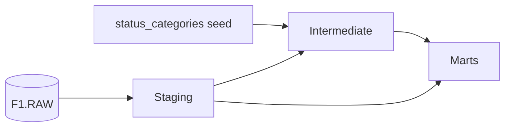

# F1: car or driver?

A dbt project on Snowflake, built as a case study for LEAP.

## The question

In Formula 1 the car matters so much that it is hard to tell how good a driver really is. The one fair comparison is the teammate: two drivers, same team, assuming same car.

**Main question:** How does each driver do against their teammate, in qualifying and in races?

**Sub-question:** Which teams build the most reliable cars? Measured as mechanical retirements per team per season.

## The data

Formula 1 results from 1950 to 2024, loaded from CSV files into Snowflake (`F1.RAW`). Six tables are used:

| Table | What it holds |
|---|---|
| `results` | One row per driver per race: grid, finishing position, points, status |
| `qualifying` | One row per driver per qualifying session, with Q1, Q2 and Q3 times |
| `races` | One row per race: season, round, date |
| `drivers` | One row per driver |
| `constructors` | One row per team |
| `status` | The list of ways a race can end, like Finished, Engine Failure or Collision |

## How the project is built



| Layer | Built as | What happens there |
|---|---|---|
| Staging | Views | One model per raw table. Clearer column names and light cleaning, for example qualifying times turned from text into seconds. No joins. |
| Intermediate | Views | Results get a status category, and each driver is paired with their teammate, once for races and once for qualifying. |
| Marts | Tables | A fact table, two aggregated marts and three dimension tables. |

### Models

**Staging:** `stg_results`, `stg_qualifying`, `stg_races`, `stg_drivers`, `stg_constructors`, `stg_status`

**Seed:** `status_categories` groups every result status into one of six categories: finished, lapped, mechanical, driver_incident, other or unknown.

**Intermediate**
- `int_results_classified`: results with the status category and a flag for whether the driver reached the finish.
- `int_teammate_pairs`: each driver's race result next to their teammate's result from the same race.
- `int_qualifying_pairs`: the same for qualifying.

**Marts**
- `fct_teammate_races`: one row per pair of teammates per race. Who qualified ahead, who finished ahead, and the qualifying gap.
- `mart_teammate_head_2_head`: one row per pair of teammates per season. Answers the main question.
- `mart_team_reliability`: one row per team per season. Answers the sub-question.
- `dim_drivers`, `dim_constructors`, `dim_races`: names and details to join on.

## Design choices

- **Marts start in 2011.** In the 1950s drivers could share a car, and before 1994 some teams ran more than two cars. Both break the idea of one teammate per race. The start year is a variable (`start_season`) in `dbt_project.yml`.
- **Each pair appears twice,** once from each driver's side. That makes it easy to filter on one driver and see all their teammates.
- **A race only counts when both drivers reached the finish** (finished or lapped). If one car breaks down, the result says nothing about the drivers.
- **Qualifying is decided by qualifying position.** The gap in percent uses the last session both drivers took part in. A negative gap means driver 1 was faster. The season figure is the median, because single sessions can be noisy, for example when one driver is knocked out early.
- **A driver can have more than one teammate in a season,** for example when a reserve driver steps in.
- **The dimension tables read straight from staging,** Don't need any changes.

### Judgment calls in the status seed

- Tyres, punctures, fuel, stalled and handling count as **mechanical**.
- Damage counts as **driver_incident** as it is often the driver's fault.
- Debris, illness or injury, disqualified, withdrew and did not qualify count as **other**.
- "Retired" with no reason given is **unknown**.

## Tests and documentation

Every layer has a properties file with descriptions and tests.

- **Sources and staging:** `unique` and `not_null` on every ID, and relationship tests from results to races, drivers, constructors and status.
- **Seed:** every status in the raw data must have a category.
- **Intermediate:** `status_category` must be one of the six allowed values.
- **Marts:** each mart must be unique on its grain, using `dbt_utils.unique_combination_of_columns`.
- **Custom test:** `assert_one_teammate_per_race` checks that no driver has more than one teammate in the same race.

The tests found real problems during the build. Two tables had been loaded without their header row, which the source tests caught. And the unique test on `fct_teammate_races` failed on shared cars from the 1950s, which led to the 2011 start year.

## How to run it

You need a Snowflake account with the raw tables in `F1.RAW`, and a dbt connection to it.

```
dbt deps     # install dbt_utils
dbt build    # seed, run and test everything
```

To build one mart and everything it depends on:

```
dbt build --select +mart_teammate_head_2_head
```

## With more time

- A consistency mart: how much a driver's lap times vary within a race, with lap times loaded incrementally.
- Newer seasons, loaded on a schedule.
- Weather data as a second source, to see who gains on their teammate in the rain.
- Extend the comparison back to 1994, when teams settled on two cars.
- Team favouritism: does the gap between teammates grow in the second half of a season, when teams start backing their leading driver?
